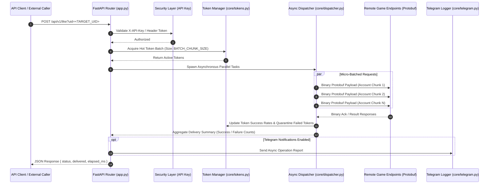

<div align="center">
  <h1>freefire-like-api</h1>
  <p>High-concurrency parallel Free Fire like automation and profile intelligence API with hot token cache and rate limiting.</p>

  <p>
    <a href="https://github.com/itsgoharrehman/freefire-like-api/releases"></a>
    <a href="LICENSE"></a>
    
    
    
    <a href="https://github.com/itsgoharrehman/freefire-like-api/stargazers"></a>
    <a href="https://github.com/itsgoharrehman/freefire-like-api/issues"></a>
  </p>
</div>

---

## Overview

freefire-like-api is a high-throughput, asynchronous API service engineered on FastAPI and AsyncIO. Designed for large-scale player profile inspection and interaction automation, the engine manages 780+ concurrent sender accounts through an in-memory token rotation pool, micro-batched Protobuf serializations, and staggered HTTP connection pooling.

The service incorporates automated token health auditing, token quarantine on authentication failure, and background Telegram notification alerts.

## Architecture and Concurrency Model



## Core Capabilities

### 1. High-Concurrency Asynchronous Dispatcher
* Micro-batched parallel dispatching via `aiohttp` and `httpx` with persistent connection pooling (`MAX_KEEPALIVE_CONNECTIONS=150`).
* Configurable stagger intervals (`BATCH_STAGGER_DELAY=0.035s`) mitigating network congestion and rate-limit drops.

### 2. Hot Token Pool Management (`core/tokens.py`)
* Active rotation across 780+ sender accounts with in-memory health tracking.
* Automated token refresh cycle (`refresh_tokens.py`) with quarantine buffers for expired or rate-limited sessions.

### 3. Native Protocol Buffers Serialization
* Low-level Protobuf encoders (`like_pb2.py`, `uid_generator_pb2.py`, `visit_count_pb2.py`) minimizing CPU overhead and wire bandwidth during high-concurrency bursts.

### 4. Enterprise Security Controls
* Unified API key enforcement via query parameter or `X-API-Key` HTTP header.
* Zero plaintext tokens exposed in client error payloads.

## Prerequisites

* **Runtime**: Python 3.10, 3.11, or 3.12.
* **Dependencies**: Listed in `requirements.txt`.
* **Tokens**: Populated account token cache in `tokens.json`.

## Installation and Quickstart

### 1. Clone the Repository

```bash
git clone https://github.com/itsgoharrehman/freefire-like-api.git
cd freefire-like-api
```

### 2. Create Virtual Environment & Install Dependencies

```bash
python -m venv venv
# Linux / macOS
source venv/bin/activate
# Windows
.\venv\Scripts\activate

pip install -r requirements.txt
```

### 3. Configure Environment

Copy the example configuration:

```bash
cp .env.example .env
```

Edit `.env`:

```env
API_KEY=your_secure_private_api_key_here
HOST=0.0.0.0
PORT=8000
BATCH_CHUNK_SIZE=40
BATCH_STAGGER_DELAY=0.035
MAX_KEEPALIVE_CONNECTIONS=150
REQUEST_TIMEOUT=10.0
TELEGRAM_BOT_TOKEN=
TELEGRAM_CHAT_ID=
```

### 4. Run the API Server

```bash
uvicorn app:app --host 0.0.0.0 --port 8000 --workers 4
```

API documentation and interactive OpenAPI schemas are available at `http://localhost:8000/docs`.

## API Endpoints Reference

| Endpoint | Method | Authentication | Description |
| :--- | :--- | :--- | :--- |
| `/api/v1/like` | `POST` | `X-API-Key` | Dispatches parallel like transactions to the specified target UID. |
| `/api/v1/player/profile` | `GET` | `X-API-Key` | Inspects player profile details, visit counts, and account metadata. |
| `/api/v1/tokens/status` | `GET` | `X-API-Key` | Returns active, expired, and quarantined token pool counts. |
| `/health` | `GET` | Public | Readiness probe returning engine status and system uptime. |

## Configuration Reference

| Variable | Type | Default | Description |
| :--- | :--- | :--- | :--- |
| `API_KEY` | String | Required | Master security key required for all `/api/v1/` endpoints. |
| `HOST` | String | `0.0.0.0` | Network binding interface. |
| `PORT` | Number | `8000` | Port for the Uvicorn ASGI server. |
| `BATCH_CHUNK_SIZE` | Number | `40` | Concurrent worker tasks spawned per micro-batch. |
| `BATCH_STAGGER_DELAY`| Number | `0.035` | Sleep delay in seconds between task waves to prevent packet bursts. |
| `MAX_KEEPALIVE_CONNECTIONS` | Number | `150` | Maximum persistent TCP connections kept alive in the client pool. |
| `REQUEST_TIMEOUT` | Number | `10.0` | Socket read timeout in seconds before task cancellation. |

## Security Considerations

* **API Key Enforcement**: Unauthenticated requests to `/api/v1/*` are rejected immediately with HTTP 403 Forbidden.
* **Token Sanitization**: Account tokens and authorization headers are never logged to console traces or error responses.
* **Rate Limiting**: Dispatcher employs micro-batch delays to conform to destination rate thresholds.

## License and Security Contact

This project is licensed under the [MIT License](LICENSE).

For responsible vulnerability reporting, please review [SECURITY.md](SECURITY.md) or contact `goharrehmanfsd260@gmail.com`.