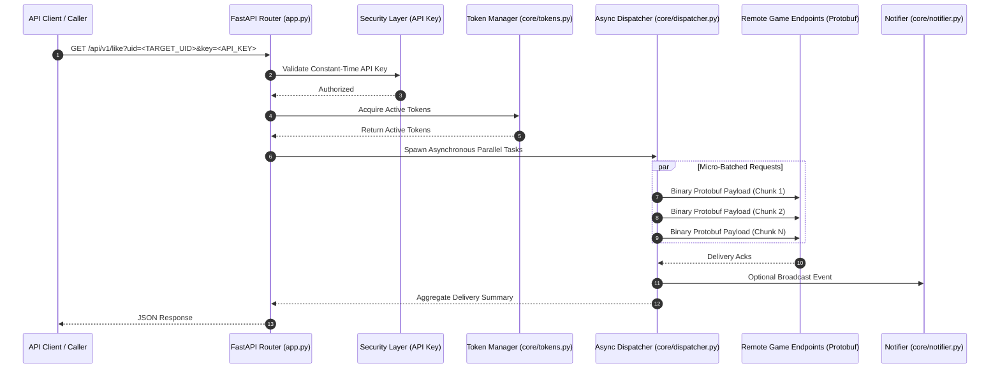

# Free Fire Like API

High-concurrency asynchronous API service for player profile inspection and interaction automation with in-memory token rotation pool and connection pooling.

---

## Overview

A standalone REST API service built with FastAPI and AsyncIO. Designed for large-scale player profile inspection and interaction automation, managing concurrent sender accounts through an in-memory token rotation pool, micro-batched Protobuf serializations, and staggered HTTP connection pooling.

The service incorporates automated token health auditing, token quarantine on authentication failure, and an optional broadcast notifier.

## Architecture



## Setup & Running

### 1. Requirements
- Python 3.10+
- Dependencies listed in `requirements.txt`

```bash
pip install -r requirements.txt
```

### 2. Configure Environment

Copy `.env.example` to `.env`:
```bash
cp .env.example .env
```

Configure your parameters:
```env
API_KEY=your_secure_api_key_here
HOST=0.0.0.0
PORT=8000
```

### 3. Run Server

```bash
uvicorn app:app --host 0.0.0.0 --port 8000
```

## API Endpoints Reference

| Endpoint | Method | Authentication | Description |
| :--- | :--- | :--- | :--- |
| `/api/v1/like` | `GET` | `X-API-Key` or `?key=` | Dispatches parallel likes to the specified target UID. |
| `/api/v1/profile` | `GET` | `X-API-Key` or `?key=` | Inspects player profile details and level. |
| `/api/v1/tokens/status` | `GET` | `X-API-Key` or `?key=` | Returns token pool metrics. |
| `/api/v1/cron/refresh` | `GET` | `X-API-Key` or `?key=` | Triggers account token refresh. |
| `/api/v1/cron/ping` | `GET` | `X-API-Key` or `?key=` | Health ping endpoint. |
| `/health` | `GET` | Public | System health probe. |

## License

This project is licensed under the [MIT License](LICENSE).
